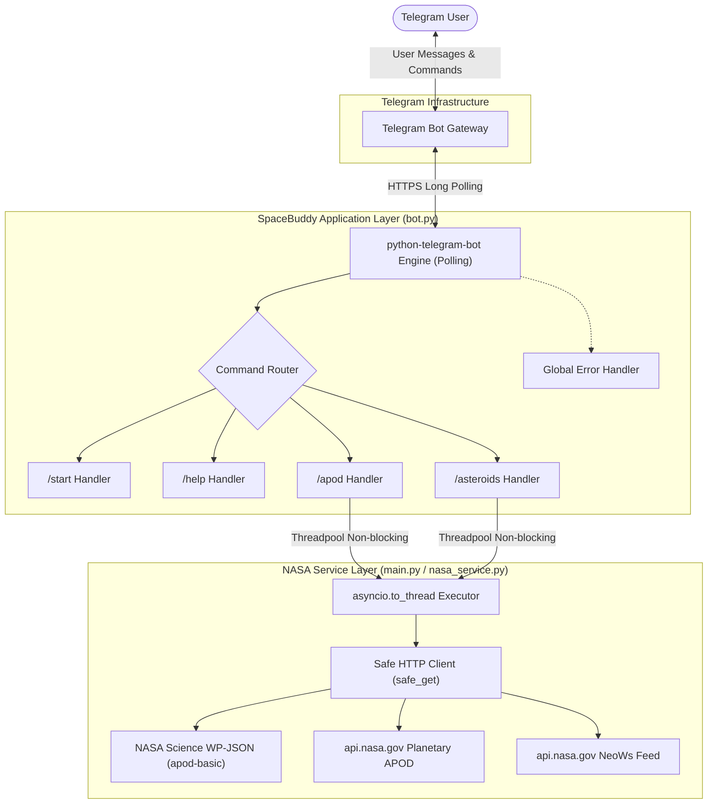
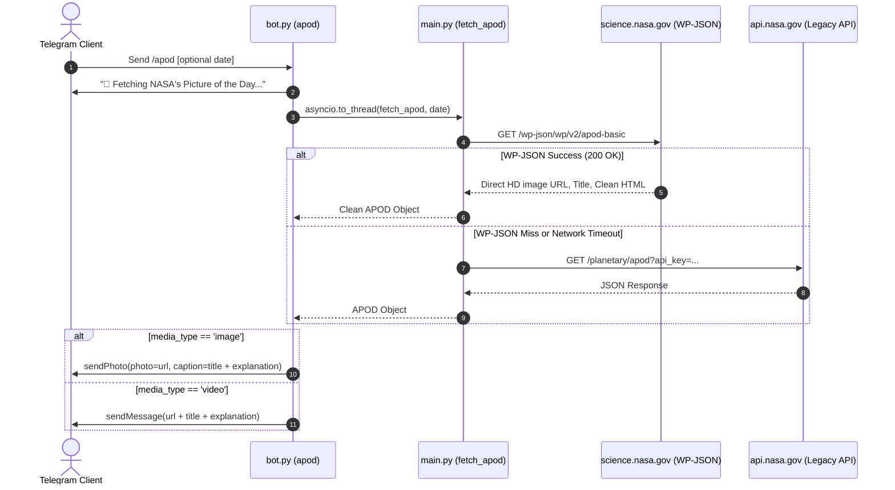
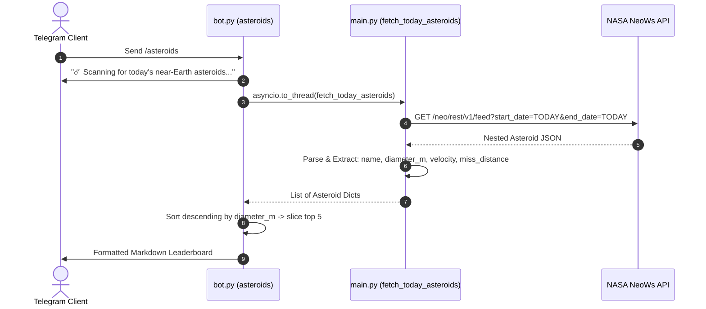
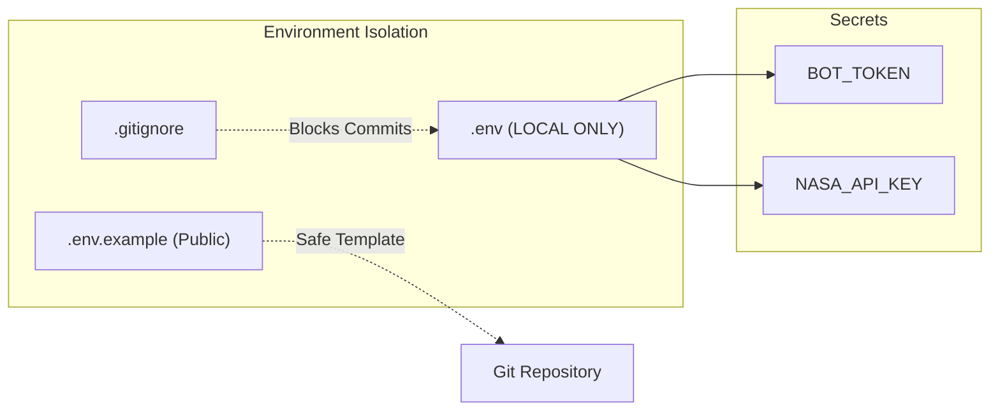
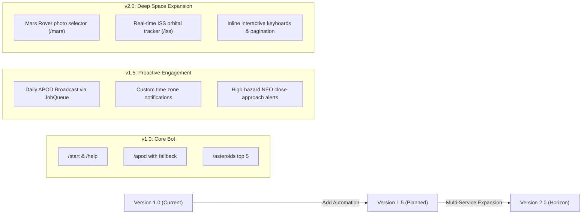

# 🪐 SpaceBuddy: Comprehensive Project Blueprint

> **System Architecture, Technical Specifications, and Implementation Blueprint**  
> **Project:** SpaceBuddy Telegram Bot  
> **Version:** 1.1.0  
> **Target Python Runtime:** 3.11+ / 3.15+  
> **Core Libraries:** `python-telegram-bot` (v22.x+), `requests`, `python-dotenv`

---

## 1. Executive Summary & Vision

**SpaceBuddy** is an asynchronous, event-driven Telegram bot designed to bridge public space exploration data directly to everyday users. By interfacing with NASA Open APIs and NASA Science portals, SpaceBuddy serves two primary functions:
1. **Daily Space Exploration:** Dispatches NASA's Astronomy Picture of the Day (APOD) alongside astronomer explanations, with support for historical date queries.
2. **Planetary Defense Awareness:** Tracks and ranks near-Earth asteroids (NEOs) approaching Earth on the current calendar day, highlighting size estimates, relative speed, miss distances, and potential hazard ratings.

---

## 2. High-Level System Architecture

SpaceBuddy follows a decoupled, modular architecture separating the **Telegram Interaction Layer** from the **NASA Data Integration Layer**.

---

## 3. Module & Component Specifications

### 3.1. `bot.py` — Telegram Interaction Engine
- **Framework:** `python-telegram-bot` (v22+) utilizing `asyncio`.
- **Concurrency Model:** Uses `asyncio.to_thread()` to offload synchronous HTTP networking from the bot's event loop, preventing polling lag.
- **Handlers:**
  | Command | Arguments | Behavior | Fallback / Safeguard |
  | :--- | :--- | :--- | :--- |
  | `/start` | None | Personalized greeting with user's first name & bot feature overview | Defaults to `"Explorer"` if first name is null |
  | `/help` | None | Markdown list of commands and usage tips | Markdown mode fallback |
  | `/apod` | `[YYYY-MM-DD]` (optional) | Fetches picture/video of the day with title & description | 1024-character caption truncation, plain text fallback on entity parse errors |
  | `/asteroids` | None | Scans today's approaching NEOs, sorts descending by max diameter, outputs top 5 | Clean empty-state message if zero objects returned |

### 3.2. `main.py` & `nasa_service.py` — Data & API Integration
- **`safe_get(url, params)`**: Custom HTTP wrapper enforcing a 10-second read/connect timeout and custom browser user-agent (`SpaceBuddy/1.0`). Suppresses runtime crashes by returning `None` on network failures.
- **`fetch_apod(target_date)`**: Dual-layer resilient fetcher:
  1. **Primary Route:** Queries `https://science.nasa.gov/wp-json/wp/v2/apod-basic`. Completely bypasses the legacy API scraper bug (`"NASA Science"` logo issue) and API key rate limits. Strips HTML markup from descriptions.
  2. **Secondary Route:** Falls back to `https://api.nasa.gov/planetary/apod` if an older date outside the 25-day cache is requested.
- **`fetch_today_asteroids()`**: Interfaces with NASA NeoWs (`/neo/rest/v1/feed`), parsing nested asteroid data into clean structured dictionaries:
  - `name`: Designation string.
  - `diameter_m`: Estimated maximum diameter in meters.
  - `is_hazardous`: Potentially hazardous asteroid boolean.
  - `velocity_kmh`: Relative velocity formatted in km/h.
  - `miss_distance_km`: Proximity to Earth at closest approach.

---

## 4. Operational Data Flows

### 4.1. APOD Command Flow & Resilience Strategy

### 4.2. Near-Earth Asteroid Feed Flow

---

## 5. Security & Configuration Architecture

- **Credential Isolation:** API keys and bot tokens are exclusively loaded via `python-dotenv`.
- **Repository Safety:** `.gitignore` actively prevents checking in `.env`, `.venv`, and IDE configuration files. A sanitized `.env.example` serves as an onboarding template.
- **Fail-Safe Fallback:** If `NASA_API_KEY` is omitted, the application degrades gracefully to `DEMO_KEY` rather than halting.

---

## 6. Error Handling & Edge Cases

| Scenario | Symptom / Potential Failure | Implemented Solution |
| :--- | :--- | :--- |
| **NASA Legacy API 500 / Timeout** | Bot crashes or user waits indefinitely | Dual-endpoint architecture: tries `science.nasa.gov` first, sets 10s request timeout |
| **APOD Scraper Bug (`NASA Science`)** | Bot sends generic NASA logo instead of APOD | Auto-detects logo URL / `"NASA Science"` title and routes to `apod-basic` endpoint |
| **Telegram Caption Limit** | `caption is too long (> 1024 chars)` | Truncates caption to 1021 characters + `"..."` ellipsis |
| **Markdown Parsing Syntax Error** | NASA description contains unmatched `_` or `*` | Nested `try/except` fallback to send plain text without `parse_mode` |
| **No Asteroid Approaches Today** | Empty response crashes index lookups | Safe key navigation (`dict.get()`) and explicit zero-count user feedback message |

---

## 7. Future Roadmap & Enhancement Horizons

