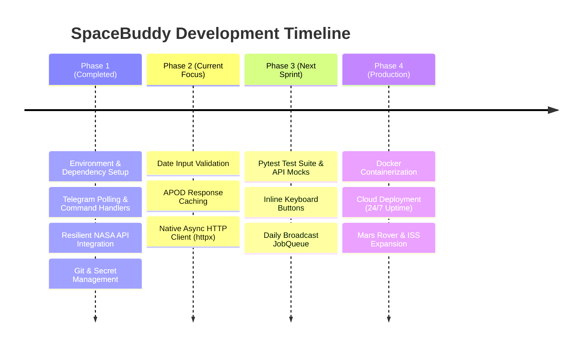

# 📋 SpaceBuddy Project Analysis & TODO Roadmap

> **Audit, Technical Analysis, and Action Plan for SpaceBuddy Telegram Bot**  
> **Date:** October 2026  
> **Status:** Phase 1 Complete (Core Bot & Resilient APIs) | Phase 2 Ready

---

## 🔍 1. Current Project Health & Analysis

### What Is Currently Working Well ✅
- **Dual-Endpoint Fallback:** `fetch_apod` seamlessly mitigates NASA's broken scraper (`"NASA Science"` logo issue) and API 500 crashes by routing to `science.nasa.gov/wp-json/wp/v2/apod-basic`.
- **Non-blocking Event Loop:** `asyncio.to_thread` ensures synchronous HTTP calls do not block Telegram bot polling.
- **Caption Truncation & Formatting:** Strict handling of Telegram's 1024-character caption limit with Markdown entity fallback.
- **Credential Isolation:** `.env` is properly ignored by Git, with an onboarding `.env.example` template provided.
- **Asteroid Metrics Parsing:** NeoWs feed correctly extracts metric diameter, velocity in km/h, and miss distance.

---

## 🎯 2. Identified Technical Debt & Gaps

| Area | Current Behavior | Risk / Limitation | Priority |
| :--- | :--- | :--- | :--- |
| **Input Validation** | `/apod <date>` passes raw string to API | Malformed dates (`/apod hello`) trigger 400 Bad Request | **High** |
| **HTTP Client Architecture** | Synchronous `requests` wrapped in threads | Higher memory/thread footprint under high concurrency | **Medium** |
| **API Caching** | NASA API is hit on every `/apod` invocation | Unnecessary bandwidth & potential rate limit hits on `DEMO_KEY` | **High** |
| **Automated Testing** | No test suites (`pytest`) | Risk of regression when updating parser logic | **High** |
| **User Interactivity** | Plain text commands only | Missed opportunity for inline buttons (e.g. "Random", "Next") | **Medium** |
| **Deployment Readiness** | Manual terminal polling | No process supervisor or containerization for 24/7 uptime | **Medium** |

---

## 📌 3. Prioritized Task Checklist

### Phase 1: Core Stabilisation & Safety (Immediate)
- [x] Fix missing `python-telegram-bot` module in `.venv`
- [x] Connect `bot.py` imports with `main.py` via `nasa_service.py`
- [x] Fix NASA APOD scraper bug (`"NASA Science"` logo bug)
- [x] Handle Telegram 1024-character caption limit
- [x] Add Markdown parsing error fallback
- [x] Configure `.gitignore` to prevent secret leakage
- [x] Write project documentation ([README.md](README.md) & [PROJECT_BLUEPRINT.md](PROJECT_BLUEPRINT.md))
- [ ] **Input Validation:** Add ISO date validator (`YYYY-MM-DD`) for `/apod` argument
- [ ] **Chat Action Indicators:** Add `context.bot.send_chat_action(chat_id, "upload_photo")` while loading media

### Phase 2: Performance & Caching (Near-Term)
- [ ] **In-Memory / TTL Cache:** Implement caching for daily APOD (avoid hitting NASA API repeatedly for the same day)
- [ ] **Switch to Native Async HTTP (`httpx`):** Replace synchronous `requests` with async `httpx.AsyncClient`
- [ ] **Robust Asteroid Filtering:** Allow user to filter asteroids by minimum diameter (e.g. `/asteroids >100m`) or hazard only (`/asteroids hazardous`)

### Phase 3: Testing & Quality Assurance
- [ ] **Unit Tests:** Set up `pytest` and `pytest-asyncio`
- [ ] **API Mocking:** Create mock fixtures for NASA APOD and NeoWs responses (testing 200, 400, 500, and malformed JSON)
- [ ] **Error Path Coverage:** Test behavior when NASA API is unreachable or rate-limited

### Phase 4: Enhanced User Experience (UI/UX)
- [ ] **Interactive Inline Buttons:**
  - `[📅 Random Date]`
  - `[⬅️ Yesterday]`
  - `[🔍 HD Image Link]`
- [ ] **Subscription & Broadcast (`JobQueue`):**
  - Allow users to subscribe via `/subscribe`
  - Daily automatic broadcast of APOD at 09:00 UTC
- [ ] **Stretch Goal — Mars Rover Photos (`/mars`):**
  - Fetch photos from Curiosity or Perseverance rovers

### Phase 5: Production Deployment & Monitoring
- [ ] **Containerization:** Create `Dockerfile` and `docker-compose.yml`
- [ ] **Health Monitoring:** Add a simple heartbeat/ping command (`/ping`)
- [ ] **Structured Logging:** Direct logs to a rotating log file (`logs/bot.log`) with log timestamps and user IDs

---

## 📊 4. Architecture Evolution Matrix

